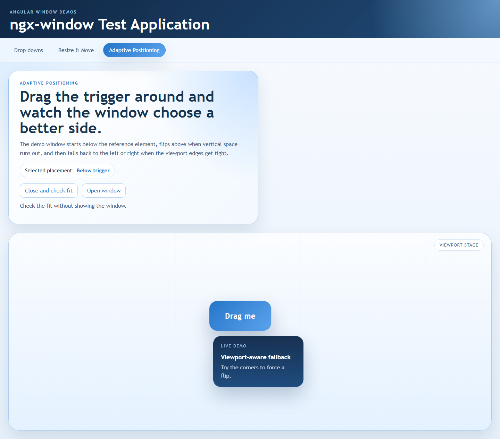
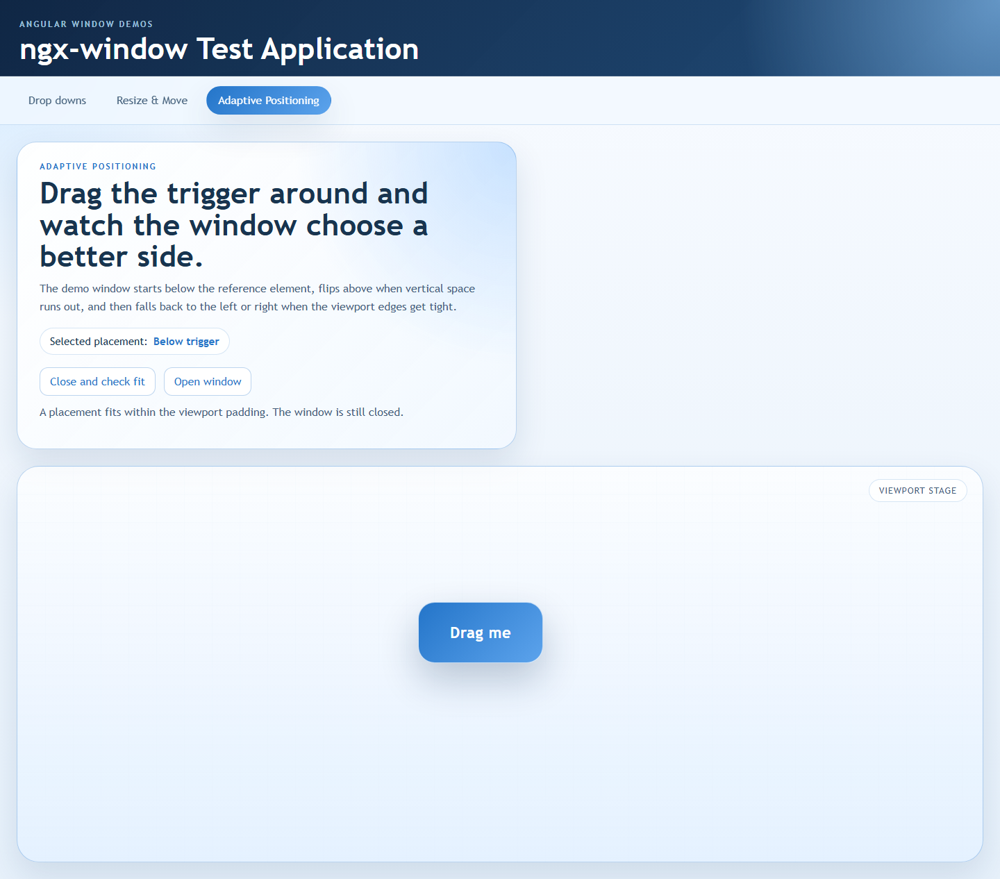

# ngx-window [](http://opensource.org/licenses/MIT)

**Note: This is essentially a beta version of sorts. It's just been released and will soon start to be tested in a real life application. Until this note is removed, expect bugs, performance issues and incomplete documentation. You're more than welcome to help by [Contributing][contrib].**

A generic, light weight, window layer component for Angular 2+ to allow front layer windows such as: dropdowns, popups, modals, tooltips, etc.
  




# Features

- Windows are not affected by attributes of the reference element's hierarchy, e.g. overflow, display, position, etc.
- Controlled from the component using it, and can be opened, closed or toggled programmatically
- Enables closing from within using the `WindowCloser` directive
- Supports alignment to the viewport, or the reference element (when exists) according to several anchor points, including viewport-aware fallback placements and anchor offsets
- Configurable automatic closing when:
    - Clicked elsewhere
    - Reference element is off view
- Automatic position adjustments upon:
    - Reference element move
    - Reference element resize
    - Reference element scroll (or container)
    - Window resize
- Fires events when the window becomes visible/invisible and when adaptive placement changes
- Checks which placement fits the viewport before opening, including windows sized by their content

# Dependencies

Latest version available for each version of Angular

| ngx-window-component | Angular |
| -------------------- | ------- |
| 0.5.1                | 21.x    |
| 0.3.0                | 20.x    |
| 0.2.1                | 19.x    |
| 0.1.0                | 18.x    |
| 0.0.10               | 17.x    |
| 0.0.7                | 16.x    |
| 0.0.5                | 13.x    |

# Install

```bash
npm install ngx-window-component --save
```

# Run demo application

Clone this repository and then:

```bash
npm install
npm run start
```

# Use

App module definition:
```typescript
@NgModule({
    imports: [ NgxWindowModule ],
    declarations: [ AppComponent ],
    bootstrap: [AppComponent]
    ...
})
export class AppModule {}
```

Drop down component template:
```html
<button (click)="dropDownWindow.toggle()" #dropDownButton>Toggle dropdown</button>
<ngx-window [refElement]="dropDownButton" [options]="{ alignment: { reference: { vertical: 'bottom' } } }"
    [width]="200" [height]="250" (visibleChange)="onVisibleChange($event)"
    (placementChange)="onPlacementChange($event)" #dropDownWindow>
    <div class="drop-down-content">
        <ng-content></ng-content>
    </div>
</ngx-window>
```

**Note: The ```NgxWindowModule``` should only be imported once and only in the module that bootstraps the application.**

# Options

| Option                             | Type    								  | Default | Description                                     									|
| ---------------------------------- | -------------------------------------- | ------- | --------------------------------------------------------------------------------- |
| visibility.startOpen               | boolean 								  | false   | The window will be become visible automatically 									|
| visibility.keepOpen.onClickOutside | boolean 								  | false   | Stay open even will clicked outside of the window hierarchy or reference element  |
| visibility.keepOpen.onIntersection | boolean 								  | false   | Stay open when the reference element gets out of view 							|
| alignment.window.horizontal        | union [see below](#horizontal-anchors) | 'left'  | Align the window according to its specified horizontal anchor 					|
| alignment.window.vertical          | union [see below](#vertical-anchors)   | 'top'   | Align the window according to its specified vertical anchor 						|
| alignment.reference.horizontal     | union [see below](#horizontal-anchors) | 'left'  | Align the window according to the reference element's specified horizontal anchor |
| alignment.reference.vertical       | union [see below](#vertical-anchors)   | 'top'   | Align the window according to the reference element's specified vertical anchor   |
| adaptivePosition.viewportPadding   | number 								  | 0       | Minimum viewport padding used when evaluating fallback placements                 |
| adaptivePosition.placements        | `AdaptivePlacement[]`                   | `[]`    | Ordered fallback placements tried after the primary placement                    |

`AdaptivePlacement` accepts `alignment`, `topOffset`, and `leftOffset`. Omitted offsets inherit from the primary placement, and are mirrored automatically when the fallback flips to the opposite side.

# Horizontal Anchors

```typescript
export type HorizontalAnchor = 'left' | 'center' | 'right';
```

# Vertical Anchors

```typescript
export type VerticalAnchor = 'top' | 'center' | 'bottom';
```

# Functions

| Function     | Parameters | Returns                  | Description                                                   |
| ------------ | ---------- | ------------------------ | ------------------------------------------------------------- |
| `open`       | *none*     | `void`                   | Opens (shows) the window                                       |
| `close`      | *none*     | `void`                   | Closes (hides) the window and cancels pending fit checks         |
| `toggle`     | *none*     | `void`                   | Opens the window if closed, or closes it if open                |
| `getBestFit`  | *none*     | `Promise<WindowBestFit>` | Measures the current content and reports the best viewport fit  |

## Checking fit before opening

`getBestFit()` waits until the next Angular render so input and content changes are applied. Automatically sized windows are measured in a temporary, invisible, noninteractive view in the window container. An already open window is measured in place. A closed window stays closed without visibility or placement events. An open window retains its rendered content and continues its normal placement notifications.

The result contains the same placement metadata as `ResolvedWindowPlacement`, plus `fitsViewport`. The primary placement is preferred, followed by the first configured fallback that fits within the viewport padding. When no placement fits, the result describes the least-overflowing placement and `fitsViewport` is `false`.

```typescript
try {
    const fit = await this.popup.getBestFit();

    if (fit.fitsViewport) {
        this.popup.open();
    }
} catch (error) {
    if (!(error instanceof DOMException && error.name === 'AbortError')) {
        throw error;
    }
}
```

When `fitsViewport` is `false`, the application can make room for the popup, for example by panning its map, before calling the existing `open()` method. Opening resolves the placement again using the updated reference position. Results are snapshots; call `getBestFit()` again after content, reference, or viewport changes when another fit decision is needed.

Pending measurements reject with an `AbortError` when the window is closed or destroyed. Measurement also rejects if the window is not initialized, if automatic sizing needs an unavailable container, or if rendering fails. A temporary measurement view is always removed before the promise settles. Fit checks use the current layout and do not wait for future image, font, or data loads; check again if those later change the content size.

The adaptive positioning demo includes **Close and check fit** and **Open window** controls so you can inspect the result before revealing the popup.



```typescript
export interface WindowBestFit extends ResolvedWindowPlacement {
    fitsViewport: boolean;
}
```

# Events

| Event             | Payload                    | Description                                                                    |
| ----------------- | -------------------------- | ------------------------------------------------------------------------------ |
| visibleChange     | `boolean`                  | Fires when the window opens or closes                                          |
| placementChange   | `ResolvedWindowPlacement`  | Fires when the resolved adaptive placement changes after placement evaluation   |

```typescript
export interface ResolvedWindowPlacement {
    offset: Offset;
    placementIndex: number;
    source: 'primary' | 'adaptive';
    alignment?: AlignmentOptions;
    topOffset: number;
    leftOffset: number;
}
```


[contrib]: https://github.com/ethan-far/ngx-window/blob/main/CONTRIBUTING.md

[](CODE_OF_CONDUCT.md)
